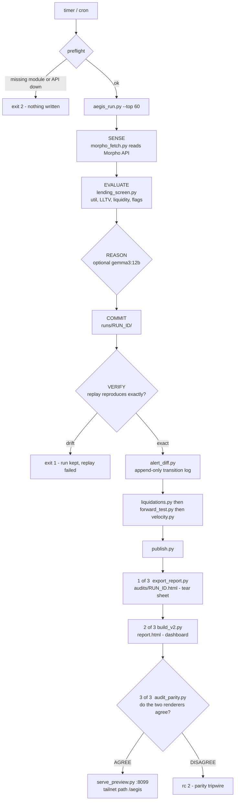
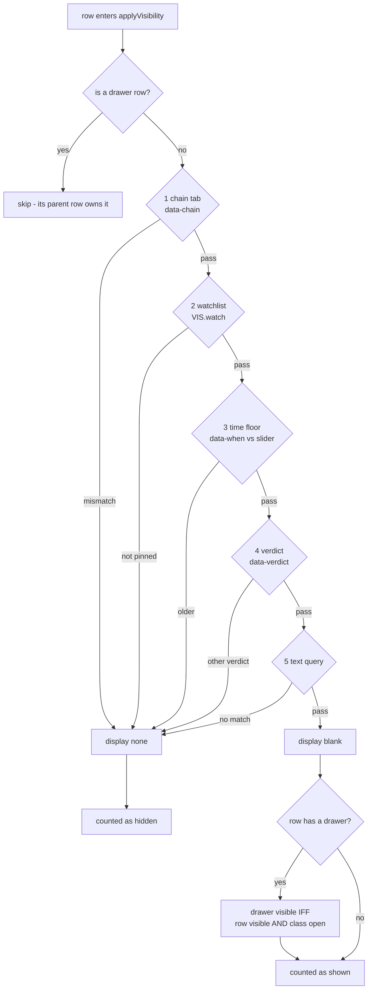
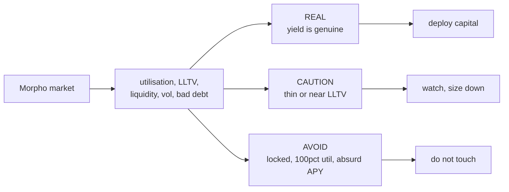

# Aegis — the three diagrams

## 1. One cycle, end to end

Failure policy: once the run is committed and replay-verified, the value is banked.
Transitions, liquidations, velocity and publish may all fail without failing the cycle.
A stale dashboard is a lesser harm than a lost run.

## 2. Why a row is visible - five dimensions, one writer

Controls never write style.display themselves. They record intent in VIS and call the
one executor. Two writers of one property is what caused every tab/filter/drawer clash.

DOM contract: table.previousElementSibling is the filter box. Four layers read it, so
anything inserted between the filter and the table silently drops the query.

## 3. Verdict to action

Run 20261020T174249Z: 60 markets, 17 REAL, 5 CAUTION, 38 AVOID.
